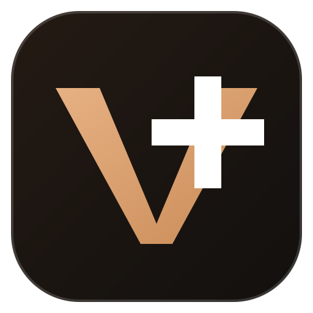

  

<h1 align="center">Volt Plus</h1>

<strong>A Minecraft Java experience, reimagined for Android.</strong>

  
  
  
  

  
  
  

---

## About

**Volt Plus** is an Android-focused continuation of the Horizon project, bringing its native Rust-based Minecraft Java 26.3 client to mobile devices with a launcher experience designed around touch input, customization, and managing game content directly on your phone.

Rather than running a conventional desktop Java launcher and a Minecraft Java runtime on Android, Volt Plus uses Horizon's native Rust game engine. It is an unofficial community project and is not affiliated with Mojang or Microsoft.

> **Project foundation:** Volt Plus is built on Horizon. The underlying game engine remains Horizon's Rust implementation; Volt Plus adds its Android launcher identity and mobile-facing work.

## At a glance

| | |
|---|---|
| Project | Volt Plus |
| Platform | Android |
| Game target | Minecraft Java Edition 26.3 |
| Engine | Horizon native Rust client |
| Rendering | Vulkan / compatibility renderer |
| Launcher UI | Android launcher with touch-first controls |
| Add-on formats | Horizon native `.hmod`, resource packs and supported shader packs |
| License | MIT (see project and third-party notices) |

## Launcher showcase

The launcher is organized around a home screen and dedicated areas for game content and configuration.

### Home

The Play screen brings together the selected profile, touch layout, renderer selection, gyroscope setting and the main launch action. Background images can be changed from the launcher.

### Mods

Browse the Horizon mod catalogue, search for entries, inspect available information and install supported native Horizon mods. Local mod files can also be imported.

**Important:** a Java mod JAR is not automatically compatible with this native engine. Fabric, Forge, NeoForge and Mixin mods that depend on Java execution cannot be treated as supported merely by importing their files.

### Resource packs

Browse the resource-pack catalogue, search for packs, and import supported pack files from device storage.

### Shader packs

Browse available Horizon-native shader packs and manage supported shader content. The shader catalogue distinguishes Horizon-native shaders from the separate Modrinth source.

### Installed content

The Installed area provides a local library for managing imported mods, resource packs and shaders, alongside file-manager access.

### Skins & capes

Import local PNG skins, keep a local skin gallery, preview the player model and switch between Classic and Slim arm models. Cloud account actions are separate from local appearance changes.

### Settings

Launcher settings are grouped into Video Settings, Launcher Settings, Controls, Experimental Stuff, Diagnostics and Account. The Controls area includes touch HUD and input customization.

## Screenshots

<em>Launcher screenshots are being prepared for the repository media folder.</em>

<!-- Add the seven supplied launcher screenshots to docs/media/readme/ and replace this note with the screenshot gallery. -->

## What you can do

- **Launch Minecraft 26.3** through the native Horizon client.
- **Choose a renderer mode** from the launcher, including Vulkan and compatibility options.
- **Customize touch controls**, including the in-game touch layout and available control settings.
- **Manage profiles** and select the active profile from the Play screen.
- **Browse and install supported Horizon mods** from the catalogue or import local files.
- **Browse and import resource packs** supported by the client.
- **Browse and activate supported Horizon-native shader packs.**
- **Manage installed content** from the local library and file manager.
- **Import and preview local skins** and choose the player arm model.
- **Connect a Microsoft account** for supported online account flows.

Feature availability can vary by device, renderer, game state and account configuration. Consult the in-app information and the documentation before assuming compatibility.

## Compatibility notes

- Volt Plus targets Android devices supported by the current project build. A matching CPU architecture does not guarantee that a device's GPU driver or available memory will support every rendering path.
- Vulkan and compatibility rendering have different device requirements; use the renderer option appropriate for your device.
- The current game target described by the Android documentation is Minecraft Java 26.3. This is not a promise of support for arbitrary Minecraft versions.
- Native Horizon `.hmod` packages are distinct from Java mod-loader JARs.
- Use a legitimate Minecraft account for authenticated gameplay and online services.

## Download

Get builds from the repository's **[GitHub Releases](https://github.com/entitybrian69-bit/volt-plus/releases)** page.

1. Open the Releases page.
2. Choose a release and review its notes and attached APK.
3. Download the APK that matches your device architecture, when multiple builds are provided.
4. Install it on your Android device. Android may ask you to allow installation from the source you used.

If no release is published yet, the Releases page may be empty. Do not download APKs from unofficial mirrors.

## Community

Questions, feedback, troubleshooting and community discussion:

- **[Join the Volt Plus Discord](https://discord.gg/WsBxGsKyhU)**
- **[Browse the source code](https://github.com/entitybrian69-bit/volt-plus)**
- **[View releases](https://github.com/entitybrian69-bit/volt-plus/releases)**

## Development

Volt Plus is based on a Rust workspace and Android launcher code. The repository includes Android build tooling and platform-specific documentation.

Before building, read:

- [Android documentation](docs/android.md)
- [Android contribution guide](CONTRIBUTING_ANDROID.md)
- [General contribution guide](CONTRIBUTING.md)
- [Third-party notices](THIRD_PARTY_NOTICES.md)

Build requirements and commands can change with the project. Follow the instructions in the repository rather than relying on copied commands from an older release.

## Credits and acknowledgements

Volt Plus builds on the work of the **[Horizon project](https://github.com/GoyDevv/Horizon-Android)** and the wider Rust, wgpu and Android open-source ecosystems. Please review the repository's license files and third-party notices for attribution and component-specific terms.

Minecraft is a trademark of Mojang AB. Volt Plus is an independent, unofficial project and is not approved by, sponsored by or affiliated with Mojang or Microsoft.

## Owner

<strong>Entitybrian</strong> Founder and maintainer of Volt Plus

---

  <strong>Volt Plus</strong> · Built for mobile. Powered by Horizon.

