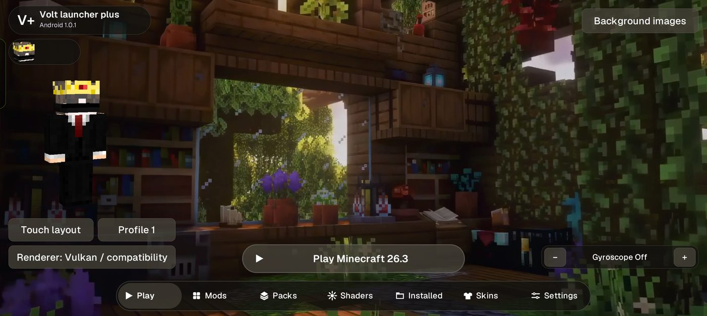
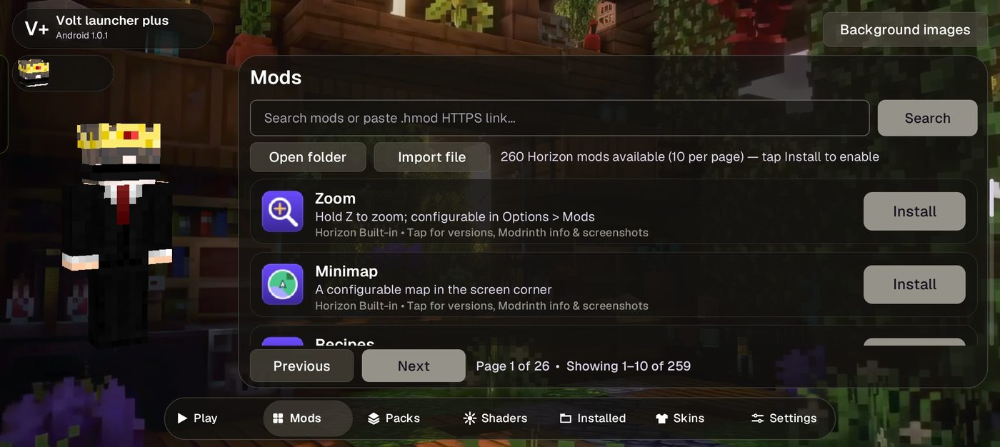
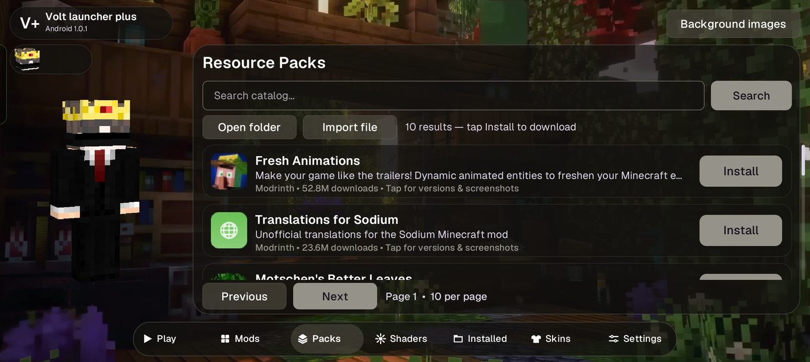
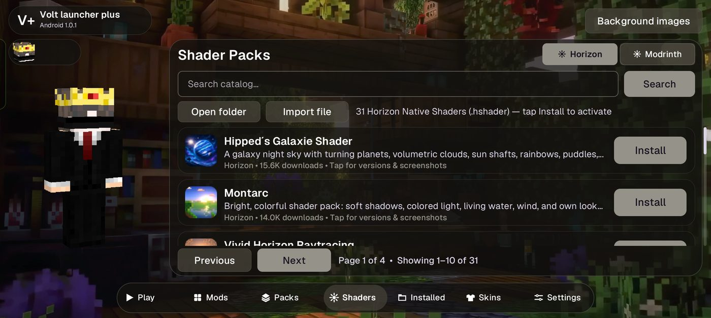
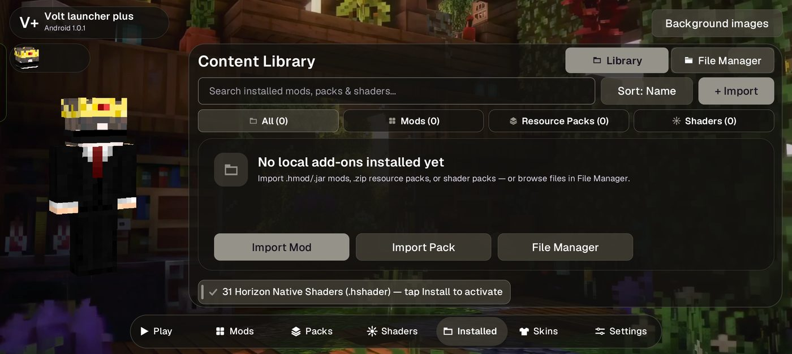
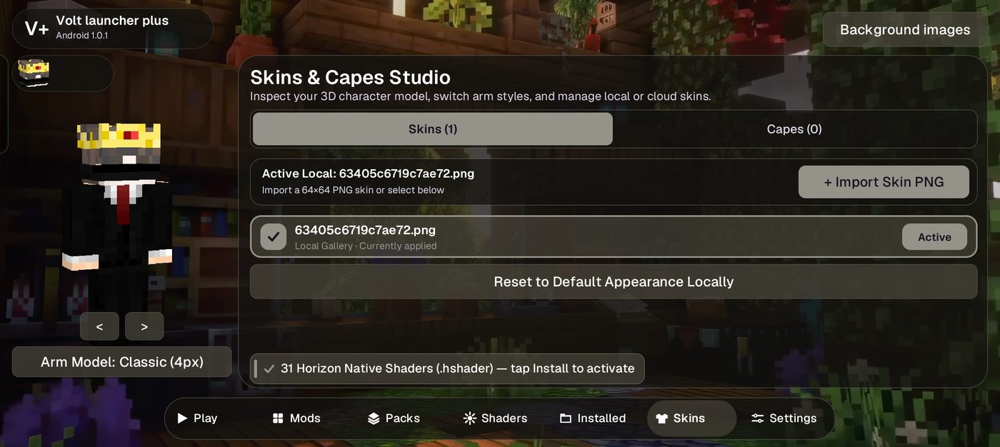
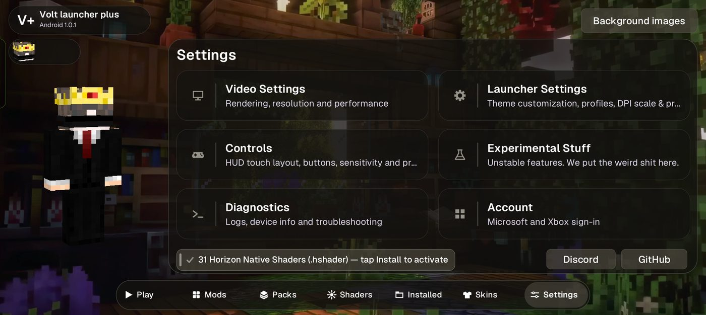

<p align="center">
  
</p>

<h1 align="center">Volt Plus</h1>

<p align="center">
  <b>A high-performance native Android port of Minecraft: Java Edition 26.3, rewritten in Rust with <code>wgpu</code> (Vulkan &amp; OpenGL ES).</b>
</p>

<p align="center">
  <a href="https://github.com/entitybrian69-bit/volt-plus/releases"></a>
  <a href="https://github.com/entitybrian69-bit/volt-plus/releases/latest"></a>
  <a href="https://github.com/entitybrian69-bit/volt-plus/releases"></a>
</p>

<p align="center">
  <a href="https://discord.gg/WsBxGsKyhU"></a>
  <a href="LICENSE"></a>
  <a href="https://github.com/entitybrian69-bit/volt-plus"></a>
  <a href="https://github.com/entitybrian69-bit/volt-plus"></a>
</p>

<p align="center">
  <a href="https://github.com/entitybrian69-bit/volt-plus/releases/latest"><b>⬇ Download the latest APK</b></a>
  &nbsp;·&nbsp;
  <a href="https://discord.gg/WsBxGsKyhU"><b>💬 Discord</b></a>
  &nbsp;·&nbsp;
  <a href="docs/android.md">Build guide</a>
  &nbsp;·&nbsp;
  <a href="CONTRIBUTING_ANDROID.md">Contributing</a>
</p>

**Android 9+ (API 28–35) · Vulkan 1.0+ / GLES 3.0 · Full SAF read & write · In-app updater · 260 FPS uncapped · Java multiplayer**

---

## Watch the intro

<p align="center">
  <a href="https://github.com/entitybrian69-bit/volt-plus/blob/android/packaging/android/media/intro.mp4?raw=true" title="Play the intro with sound">
    
  </a>
  <br />
  <a href="https://github.com/entitybrian69-bit/volt-plus/blob/android/packaging/android/media/intro.mp4?raw=true"><b>▶ Play the intro with sound</b></a>
  <br />
  <sub>The same 5-second clip the launcher plays on first start (<code>packaging/android/media/intro.mp4</code>, 1080p60, 4.2 MB).</sub>
</p>

---

## Screenshots

<p align="center">
  
</p>

| **Mods** | **Resource Packs** |
| :---: | :---: |
|  |  |

| **Shader Packs** | **Content Library** |
| :---: | :---: |
|  |  |

| **Skins & Capes Studio** | **Settings** |
| :---: | :---: |
|  |  |

---

## What's inside

- 🚀 **Full read/write storage**: import, export, move, rename and delete across external storage through the Storage Access Framework.
- 📁 **Content library**: mods (`.hmod`), resource packs and shaders in one place, with a built-in file manager for the folders behind them.
- 🔄 **In-app updater**: checks GitHub releases on start, downloads in the background, shows the changelog and installs the APK.
- ⚡ **Performance**: uncapped frame rate up to 260 FPS, battery-saver VSync mode, resolution scaling 25–100 %, fast chunk uploads, cave and entity culling.
- 🎮 **Touch controls**: four control styles including MCPE Bedrock, dynamic floating joystick, the Volt+ Control Hub and a full on-screen layout editor with opacity and sizing.
- 🎬 **Screen recorder**: 240p–1440p × 30–165 FPS, microphone / in-game / no audio, raw gameplay (HUD hidden) or with controls, straight into `Movies/VoltPlus`.
- 🌐 **Java multiplayer**: direct connections to Java Edition servers and LAN worlds, online or offline mode.

---

## Building from source

### Prerequisites
- **Android SDK** (API 35, Build-Tools 35.0.0+)
- **Android NDK** (28.2.13676358 / r28+)
- **Rust toolchain** (1.90+ with the `aarch64-linux-android` and `armv7-linux-androideabi` targets)
- **JDK** 17 or 21
- **Python** 3.10+

### Build the APK
```sh
# Signed ARM64 build
python3 tools/android_build.py --abi arm64-v8a --public --profile release

# 32-bit ARM build
python3 tools/android_build.py --abi armeabi-v7a --public --profile release
```

The output lands under `.local/android/apk/`. Full developer documentation is in [docs/android.md](docs/android.md).

---

## Contributing

Contributions, bug reports and optimisations are welcome.
- Read [CONTRIBUTING_ANDROID.md](CONTRIBUTING_ANDROID.md) before opening a pull request.
- Run the self-checks first:
  ```sh
  python3 -m unittest discover -s tests -p 'test_android*.py'
  python3 tools/check_public_tree.py
  ```

---

## License & legal

- Code is licensed under the **[MIT License](LICENSE)**.
- Minecraft is a trademark of Mojang Synergies AB. This project is not affiliated with, endorsed by or associated with Mojang or Microsoft.
- No proprietary game assets, jars or binary resources are stored in this repository.

---

<p align="center">
  
</p>

<h3 align="center">Owner</h3>

<p align="center">
  <b>Volt Plus</b> is built and maintained by its owner.<br />
  Questions, bug reports and builds: <a href="https://discord.gg/WsBxGsKyhU">Discord</a> · <a href="https://github.com/entitybrian69-bit/volt-plus">GitHub</a>
</p>
